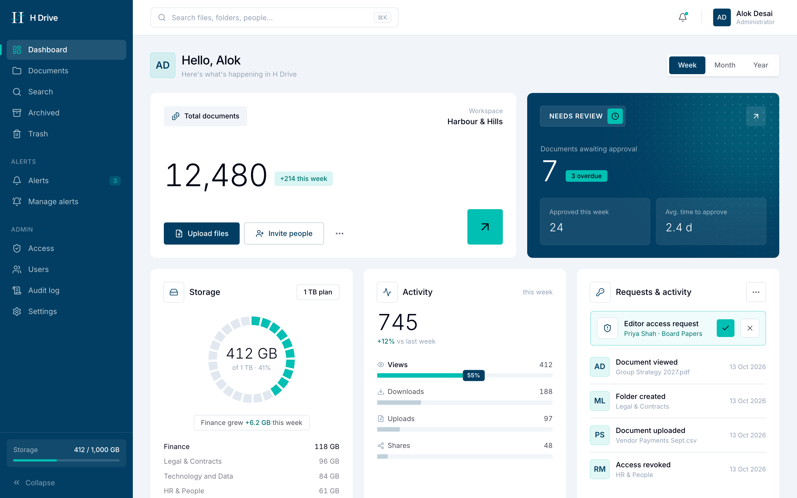
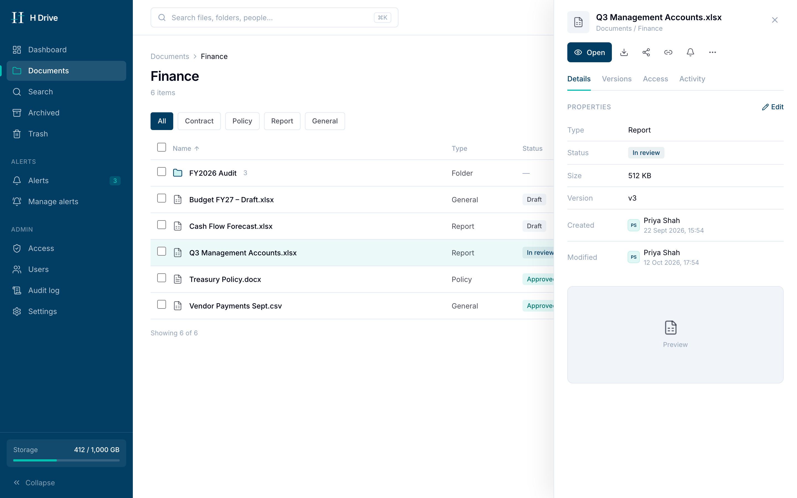
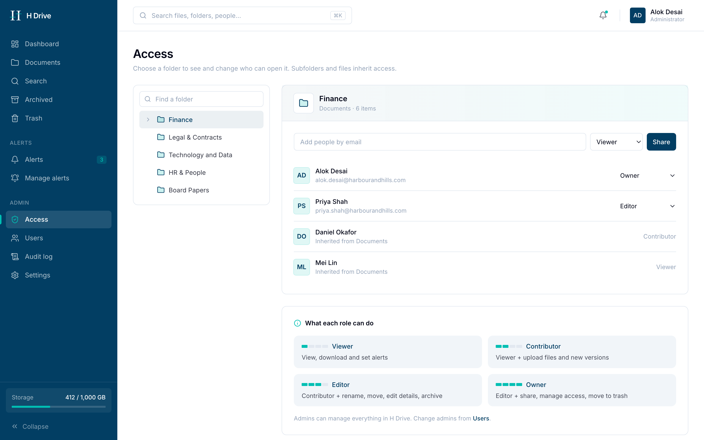
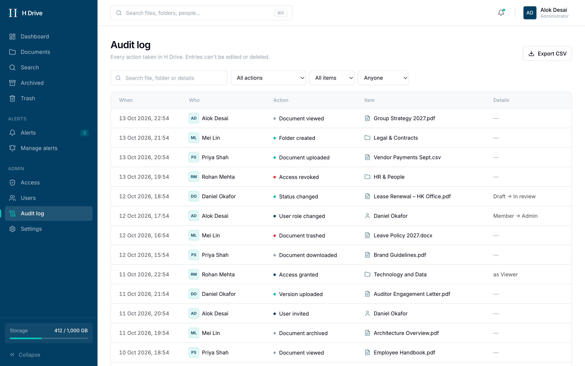
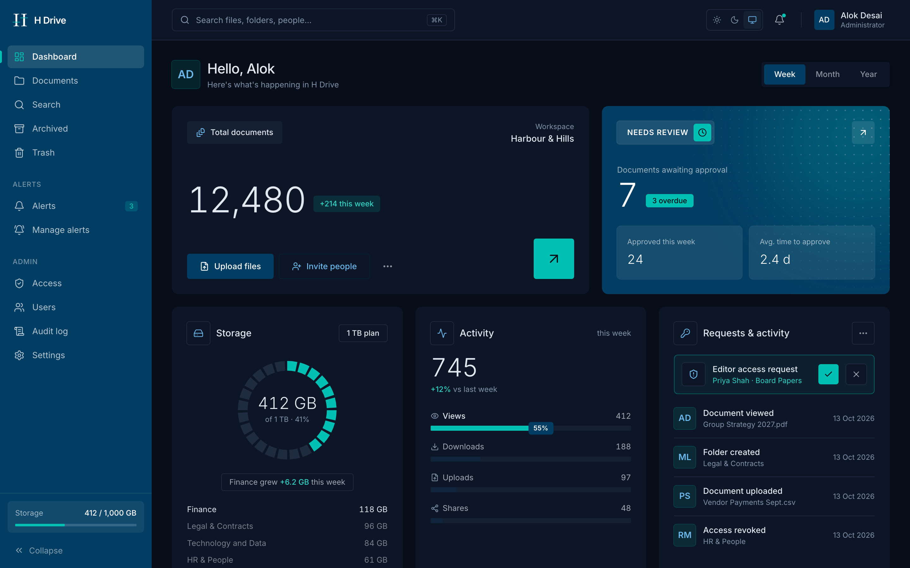
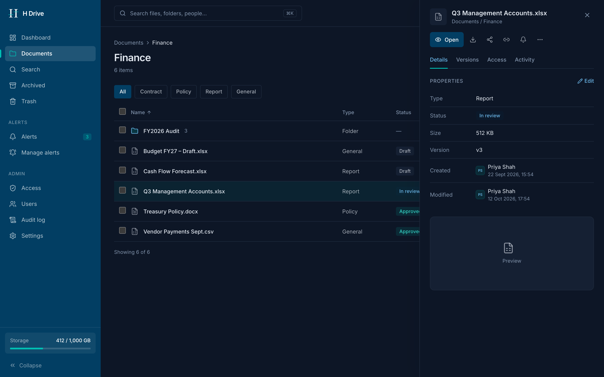
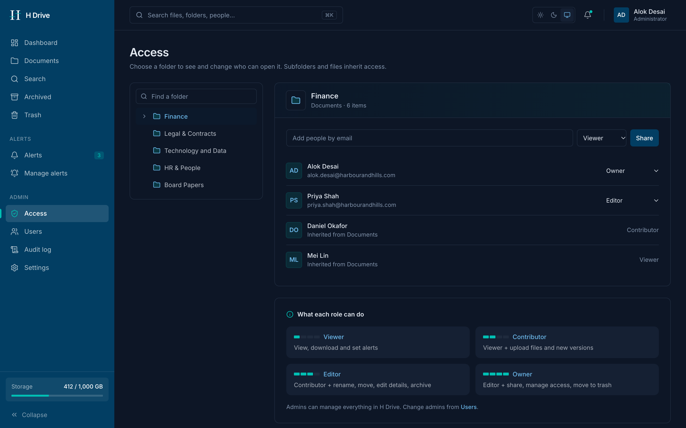
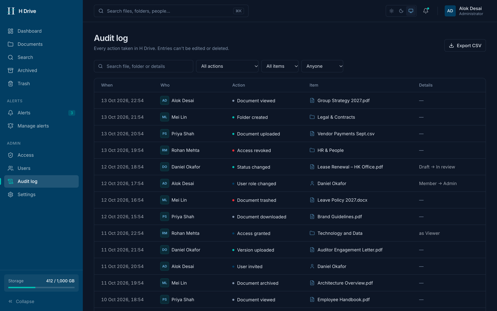

<div align="center">


# H Drive

**Harbour & Hills' internal document workspace: one secure home for every file, folder and decision.**

[Live preview](https://h-drive.vercel.app) · [Conceptual model](docs/model.md) · [API contract](app/src/types.ts)


</div>

---

> [!NOTE]
> **This is a frontend design prototype.** Every screen runs on mock data so it can be reviewed and approved before the backend team wires it up. Buttons and modals are visual only unless noted.

<picture>
  <source media="(prefers-color-scheme: dark)" srcset="docs/screens/dashboard-dark.png" />
  
</picture>

## Screens

| | |
|---|---|
|  |  |
| **Documents:** browse folders, filter by type, list/grid views, bulk actions, drag-and-drop upload, and a details drawer (properties, versions, access, activity). | **Access:** folder tree, share by email with a role, inherited access, and a role guide. |
|  | |
| **Audit log:** immutable record of every action, with filters, colour-coded actions, paging and CSV export. | |

### Dark mode

Light, Dark or System (default), from the switch in the top bar. The choice is remembered per browser.

| | |
|---|---|
|  |  |
|  |  |

### Status

| Screen | Status |
|---|---|
| Dashboard | ✅ Designed |
| Documents + details drawer | ✅ Designed |
| Access | ✅ Designed |
| Audit log | ✅ Designed |
| Users, Settings | ⏳ Next |
| Search, Archived, Trash | ⏳ Next |
| Alerts, Manage alerts | ⏳ Next |
| Modals (new folder, share, move, rename, confirm) | ⏳ Next |

## Design language

| Token | Hex | Role |
|---|---|---|
|  Navy | `#023e63` | Sidebar, primary actions, emphasis |
|  Teal | `#00bfb3` | Highlights, selection, focus, positive change |
|  Ink | `#020617` | Primary text |
|  Slate | `#94a3b8` | Secondary text, icons |
|  Mist | `#f1f5f9` | Canvas, subtle fills |

- **Themes:** light + dark from one set of colour roles (`surface`, `fg`, `accent`…) in [`index.css`](app/src/index.css)
- **Type:** Inter, light weights for hero numbers
- **Corners:** 4 / 6 / 10px scale, all set in [`index.css`](app/src/index.css)
- **Vocabulary:** one word per concept (*Upload*, *Share*, *Access*, *Move to trash*), defined in [`docs/model.md`](docs/model.md)

## For the backend team

The UI talks to data through **one file**, so integrating it shouldn't require touching any screen.

```
app/src/
├── types.ts      ← the API contract: Folder, Document, Version, AccessGrant, Activity…
├── api.ts        ← replace the mock bodies with real fetch calls (each has its endpoint in a comment)
├── mock.ts       ← sample Harbour & Hills data
├── ui.tsx        ← shared primitives: Button, Menu, Avatar, StatusBadge…
└── pages/        ← one file per screen
```

Expected endpoints so far:

```
GET  /folders/:id/items        GET  /items/:id/access
GET  /folders/:id/path         GET  /items/:id/activity
GET  /folders                  GET  /audit?action=&entity=&userId=&q=&page=&pageSize=
GET  /documents/:id/versions   GET  /audit/export
GET  /admin/dashboard?range=week|month|year
```

The objects, roles, document lifecycle and open questions are in **[`docs/model.md`](docs/model.md)**. Please read it before designing the schema.

## Run locally

```bash
cd app
npm install
npm run dev     # http://localhost:5173
```

<div align="center">
<sub>Built for Harbour &amp; Hills · Internal use only</sub>
</div>
