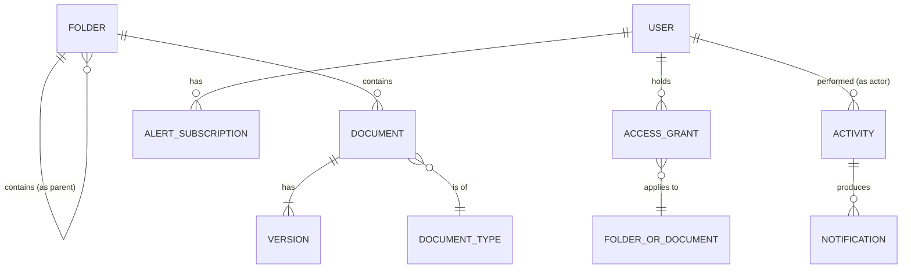
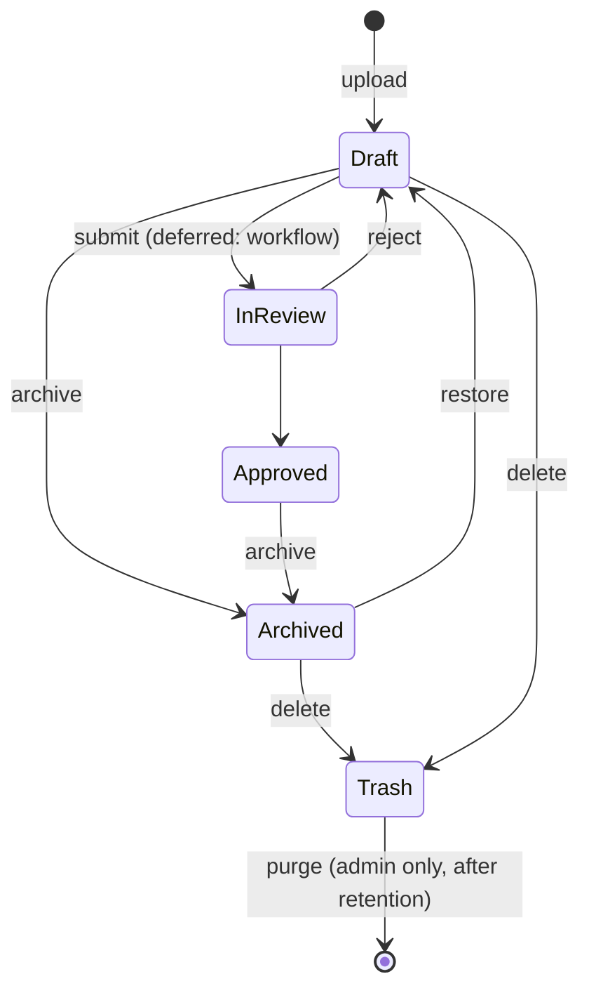

# H Drive — Conceptual model & flow map

Source: reference screens (DocuWorkspace) + agreed admin scope. No user research yet, so this is a **hypothesis** — confirm with backend & admins.

## Objects

| Object | What it is | Key attributes | Relationships |
|---|---|---|---|
| **Folder** | A container that organises items and carries access | name, created/modified, archived? | in 0..1 Folder (parent); contains many Folders & Documents |
| **Document** | A file the organisation keeps | name, type, status, size, current version, created/modified, archived? | in 1 Folder; has 1..n Versions; has 0..n Sign-offs |
| **Version** | One uploaded revision of a Document | number, size, uploaded by/at, note | belongs to 1 Document |
| **User** | A member of the organisation | name, email, system role, active? | — |
| **Access grant** | A user's role on a Folder or Document | role | 1 User → 1 Folder *or* Document; inherited down the tree |
| **Alert subscription** | A user's "tell me when this changes" | events, channel (in-app/email) | 1 User → 1 Folder or Document |
| **Notification** | One thing that happened, delivered to a subscriber | event, read? | from 1 Activity, to 1 User |
| **Activity (audit event)** | An immutable record of an action | action, at, details | by 1 User, on 1 Folder/Document/User |
| **Document type** | Admin-managed category (Contract, Policy, General…) | name, colour | used by many Documents |
| **Sign-off** *(provisional)* | An approval on a Document | approver, decision, at | Workflow is deferred — UI placeholder only |

## Document lifecycle

- **Archived** = read-only, hidden from the main list, searchable from Archived.
- **Trash** = recoverable soft delete. Purge is admin-only. *(The reference had a hard "Delete" — we're replacing it with soft delete.)*

## Roles (one ladder, each includes the one below)

| Role | Can |
|---|---|
| Viewer | view, download, subscribe to alerts |
| Contributor | + upload, new version |
| Editor | + rename, move, edit metadata, archive |
| Owner | + share / manage access, delete |
| Admin *(system role, not a grant)* | everything, everywhere + Users, Settings, Audit |

The reference listed "Admin" as a per-folder role. We're making Admin a system role so it doesn't get mixed up with Owner.

## Vocabulary

| Use | Not | Why |
|---|---|---|
| Upload | Create, Add (for files) | Files are uploaded; only folders are *created* |
| New folder | Create folder, Add folder | One verb per operation |
| Share | Grant, Permissions (as a verb) | Users "share"; the admin screen is called **Access** |
| Access | Permissions | Clearer to non-technical staff |
| Archive / Restore | Hide | |
| Move to trash / Delete forever | Delete (ambiguous) | Splits the reversible action from the permanent one |
| Activity | Audit history (in user-facing copy) | "Audit log" is kept as the admin page title |
| Alert | Notification, subscription (in UI) | "Alert me" = subscribe; "Alerts" = feed |

## Places (screens)

| Place | Main actions |
|---|---|
| Dashboard | glance: storage, recent activity, pending items |
| Documents (folder browse) | open, upload, new folder, share, move, archive, trash; bulk select |
| ↳ Details drawer | metadata edit, versions, access, activity, alert me |
| ↳ Document page | preview, version history (full width) |
| Search | query + type/status/folder/date filters |
| Archived | browse, restore |
| Trash | restore, delete forever (admin) |
| Alerts | feed, mark read; → Manage alerts (toggle/remove) |
| Access | pick item → grant by email + role, revoke, see inherited |
| Users *(admin)* | invite, change system role, deactivate |
| Audit log *(admin)* | filter, export CSV |
| Settings *(admin)* | document types, statuses, retention |

### Edge cases each screen must show
empty · loading · no permission · upload failed / partially failed · name conflict on upload · revoking the last Owner (blocked) · item archived while it's open

## Open questions for backend
1. Is the access grant inherited at read time or copied down to children? (Affects what "inherited" shows.)
2. How long are items kept in trash before they're purged?
3. Should Document status stay manual until workflows ship?
4. Is search full-text (file content) or names and metadata only?
5. **Access requests** (shown on the Dashboard): a user asks for a role on a Folder/Document → an Owner/Admin approves or declines. Needs an `AccessRequest` object (requester, item, role, status: pending/approved/declined).
